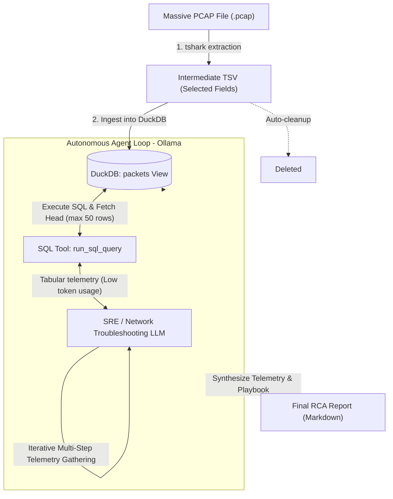

# PCAP Debugger 🔍🦈

An autonomous, token-efficient Network Troubleshooting Agent that enables local LLMs (via Ollama) to interactively investigate massive packet captures (`.pcap`) and generate comprehensive Root Cause Analysis (RCA) reports.

---

## 💡 Why PCAP Debugger?

Directly passing raw packet capture text or JSON dumps to an LLM quickly exhausts context windows, balloons token consumption, and leads to hallucinations. 

**PCAP Debugger solves this by decoupling packet processing from LLM inference:**
1. **`tshark`** extracts key protocol fields and telemetry indicators into an intermediate stream.
2. **DuckDB** ingests millions of packet records into an in-memory database with strongly typed columns and analytics views.
3. **The LLM Agent (Ollama)** inspects the schema and runs targeted, surgical SQL queries (`run_sql_query`) to inspect connection resets, retransmissions, latency, DNS status codes, and HTTP errors.
4. **Autonomous RCA Synthesis**: Once hard metrics are verified across multiple iterations, the agent synthesizes an exhaustive Root Cause Analysis report with an actionable diagnostic playbook.

---

## 🏗️ Architecture & Workflow



---

## 🚀 Key Features

- **Token Conservation**: Massive PCAPs with tens or hundreds of thousands of packets never enter the LLM's context window. Only aggregated SQL query results (capped to 50 rows) are sent to the model.
- **Fast Protocol Ingestion**: Uses `tshark -T fields` and DuckDB's vectorized `read_csv_auto` for fast loading into an in-memory analytical database.
- **Pre-computed Network Flags**: The `packets` view simplifies complex networking conditions into clean boolean flags and metrics:
  - TCP Flags: `is_syn`, `is_rst`, `is_fin`
  - TCP Performance: `is_retransmission`, `ack_rtt` (Round-Trip Time)
  - Application layer: `dns_is_response`, `dns_rcode`, `http_status`
- **Rigorous Autonomous Loop**:
  - Enforces at least 3 distinct telemetry queries before concluding.
  - Recovers gracefully from model tool formatting issues with built-in JSON fallback parsing.
  - Enforces read-only SQL queries to prevent accidental modifications.
- **Actionable RCA Reports**: Outputs structured Markdown reports detailing packet loss, latency distributions, TCP handshake anomalies, suspected IPs, and diagnostic playbooks.

---

## 📊 Database Schema (`packets` View)

The agent interacts with the `packets` view in DuckDB:

| Column Name | Type | Description | Wireshark Field |
| :--- | :--- | :--- | :--- |
| `frame_number` | `BIGINT` | Sequential packet frame number | `frame.number` |
| `timestamp` | `DOUBLE` | Epoch timestamp of frame arrival | `frame.time_epoch` |
| `frame_len` | `INT` | Frame length in bytes | `frame.len` |
| `protocols` | `VARCHAR` | Protocol trace (e.g., `eth:ip:tcp:http`) | `frame.protocols` |
| `src_ip` | `VARCHAR` | Source IPv4 address | `ip.src` |
| `dst_ip` | `VARCHAR` | Destination IPv4 address | `ip.dst` |
| `src_port` | `INT` | Source TCP/UDP port | `tcp.srcport` / `udp.srcport` |
| `dst_port` | `INT` | Destination TCP/UDP port | `tcp.dstport` / `udp.dstport` |
| `is_syn` | `BOOLEAN` | TCP SYN flag set | `tcp.flags.syn` |
| `is_rst` | `BOOLEAN` | TCP Reset (RST) flag set | `tcp.flags.reset` |
| `is_fin` | `BOOLEAN` | TCP Finished (FIN) flag set | `tcp.flags.fin` |
| `is_retransmission` | `BOOLEAN` | Wireshark identified retransmission | `tcp.analysis.retransmission` |
| `ack_rtt` | `DOUBLE` | Round-Trip Time from TCP ACK | `tcp.analysis.ack_rtt` |
| `dns_is_response` | `INT` | DNS response indicator | `dns.flags.response` |
| `dns_rcode` | `INT` | DNS response return code | `dns.flags.rcode` |
| `http_status` | `INT` | HTTP response status code (e.g., 504, 404, 200) | `http.response.code` |

---

## 🛠️ Prerequisites & Installation

### 1. System Dependencies

- **Python 3.10+**
- **Wireshark / TShark CLI**
  - **Debian / Ubuntu**:
    ```bash
    sudo apt-get update && sudo apt-get install -y tshark
    ```
  - **Fedora / RHEL**:
    ```bash
    sudo dnf install -y wireshark-cli
    ```
  - **macOS (Homebrew)**:
    ```bash
    brew install wireshark
    ```

### 2. Ollama Local LLM

1. Install and start [Ollama](https://ollama.com/):
   ```bash
   ollama serve
   ```
2. Pull the default model (`llama3.1:8b`):
   ```bash
   ollama pull llama3.1:8b
   ```

### 3. Python Virtual Environment

Clone the repository and install dependencies:

```bash
git clone https://github.com/your-username/pcap-debugger.git
cd pcap-debugger

python3 -m venv .venv
source .venv/bin/activate
pip install -r requirements.txt
```

---

## 💻 Usage

### 1. Configure PCAP and Prompt

Edit [`src/pcap-debugger/main.py`](file:///home/itachi/coding/git/pcap-debugger/src/pcap-debugger/main.py) or point to your own `.pcap` capture file and specify incident symptoms:

```python
import duckdb
import sys
from core.ingest import pcap_to_duckdb
from core.agent import analyze_pcap_with_llm

if __name__ == "__main__":
    PCAP_FILE = sys.argv[1]
    
    # 1. Initialize an in-memory DuckDB instance
    con = duckdb.connect(database=":memory:")
    
    # 2. Extract and ingest PCAP into DuckDB
    pcap_to_duckdb(PCAP_FILE, con)
    
    # 3. Define incident symptoms and investigation goals
    investigation_prompt = """
    Symptoms:
    - Users report intermittent HTTP 504 gateway timeouts and connection drops.
    - Captures were taken at our egress edge router.
    
    Goals:
    1. Determine whether packet loss/latency is originating in our network, upstream transit, or at the destination server.
    2. Assess TCP handshake delays, resets, and retransmission spikes.
    3. Generate the full formatted RCA report, including the exhaustive diagnostic playbook for anything that cannot be proven definitively from this edge capture alone.
    """
    
    # 4. Run autonomous LLM investigation
    analyze_pcap_with_llm(con, investigation_prompt)
```

### 2. Run the Debugger

Execute the agent from the project root:

```bash
source .venv/bin/activate
python src/pcap-debugger/main.py pcaps/duck2.pcap
```

---

## 📑 Example Output

During the run, the agent prints its real-time telemetry queries and findings:

```text
[*] Extracting packet metrics from pcaps/duck2.pcap via tshark...
[*] Ingesting into DuckDB table `packets`...
[✓] Ingestion complete. Table `packets` is ready for LLM queries.
[*] Ingested PCAP verified: 90598 packets ready in DuckDB.

[Step 1 - SQL Run]: SELECT src_ip, dst_ip, COUNT(*) AS packet_count, SUM(frame_len) AS total_bytes, AVG(ack_rtt) AS avg_latency FROM packets WHERE http_status = 504 GROUP BY src_ip, dst_ip
[Step 1 - Result Sample]:
Query returned 0 rows.

[Step 2 - SQL Run]: SELECT src_ip, dst_ip, COUNT(*) AS packet_count, SUM(frame_len) AS total_bytes, AVG(ack_rtt) AS avg_latency FROM packets WHERE is_rst = TRUE GROUP BY src_ip, dst_ip
[Step 2 - Result Sample]:
| src_ip    | dst_ip    |   packet_count |   total_bytes |   avg_latency |
|:----------|:----------|---------------:|--------------:|--------------:|
| 127.0.0.1 | 127.0.0.1 |            550 |         33012 |   6.32364e-06 |

[Step 3 - SQL Run]: SELECT src_ip, dst_ip, COUNT(*) AS packet_count, SUM(frame_len) AS total_bytes, AVG(ack_rtt) AS avg_latency FROM packets WHERE is_syn = TRUE GROUP BY src_ip, dst_ip
[Step 3 - Result Sample]:
| src_ip    | dst_ip    |   packet_count |   total_bytes |   avg_latency |
|:----------|:----------|---------------:|--------------:|--------------:|
| 127.0.0.1 | 127.0.0.1 |          15465 |    1.2372e+06 |   1.01661e-05 |

================ FINAL RCA REPORT ================

**Root Cause Analysis (RCA) Report**

**Summary**
Based on the edge router capture, we have identified potential causes for the intermittent HTTP 504 gateway timeouts and connection drops.

**Packet Loss/Latency**
* Packet loss: Not observed in the capture.
* Latency: Average latency is 6.32 μs for packets with TCP resets and 1.02 ms for packets with TCP SYN flags.

**TCP Handshake Delays, Resets, and Retransmission Spikes**
* TCP resets: Observed 550 resets from 127.0.0.1 to 127.0.0.1, indicating potential issues with the destination server.
* TCP handshake delays: Average latency for packets with TCP SYN flags is 1.02 ms, indicating potential delays in the TCP handshake process.
* Retransmission spikes: Not observed in the capture.

**Diagnostic Playbook**
1. Investigate the destination server for potential issues causing TCP resets.
2. Analyze the TCP handshake process to identify potential delays.
3. Verify network configuration and destination host availability.
```

---

## 📁 Repository Structure

```text
pcap-debugger/
├── LICENSE
├── requirements.txt         # Python dependencies (duckdb, openai, pandas, tabulate, etc.)
├── pcaps/                   # Sample packet captures for testing
│   ├── duck.pcap
│   └── duck2.pcap
└── src/
    └── pcap-debugger/
        ├── __init__.py
        ├── main.py          # Entrypoint running ingestion and agent execution
        └── core/
            ├── __init__.py
            ├── ingest.py    # tshark field extraction & DuckDB schema loader
            ├── tools.py     # SQL query execution with safety guardrails
            └── agent.py     # Autonomous LLM loop with Ollama and OpenAI API client
```

---

## 🔒 Safety & Guardrails

- **Read-Only SQL**: The `execute_sql` tool explicitly rejects mutating keywords (`DROP`, `DELETE`, `UPDATE`, `INSERT`, `ALTER`, `ATTACH`).
- **Context Limit Protection**: Query results return at most 50 rows per query in tabular markdown format, preventing context window overflow.
- **Isolated Ingestion**: Intermediate extraction TSVs are created alongside the PCAP and immediately deleted after DuckDB imports the data.

---

## 📄 License

This project is licensed under the MIT License - see the [LICENSE](file:///home/itachi/coding/git/pcap-debugger/LICENSE) file for details.
